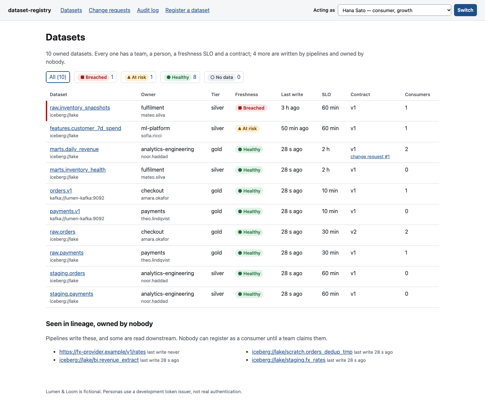
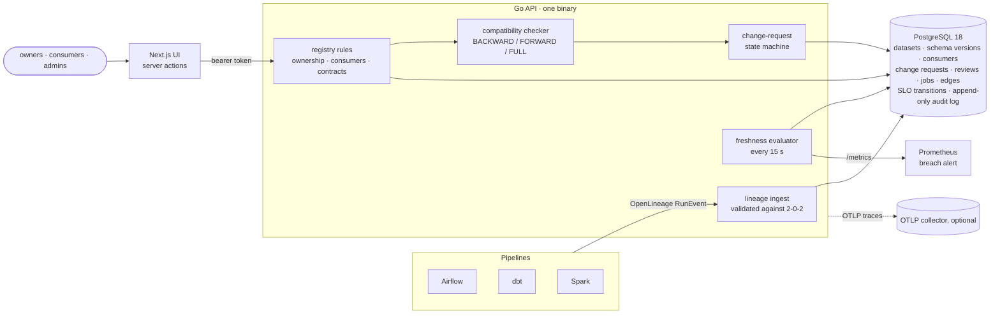
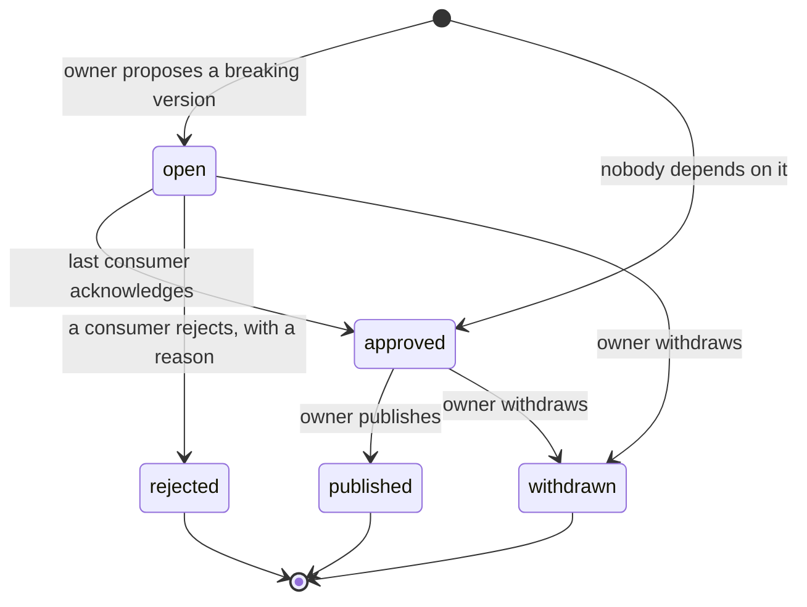
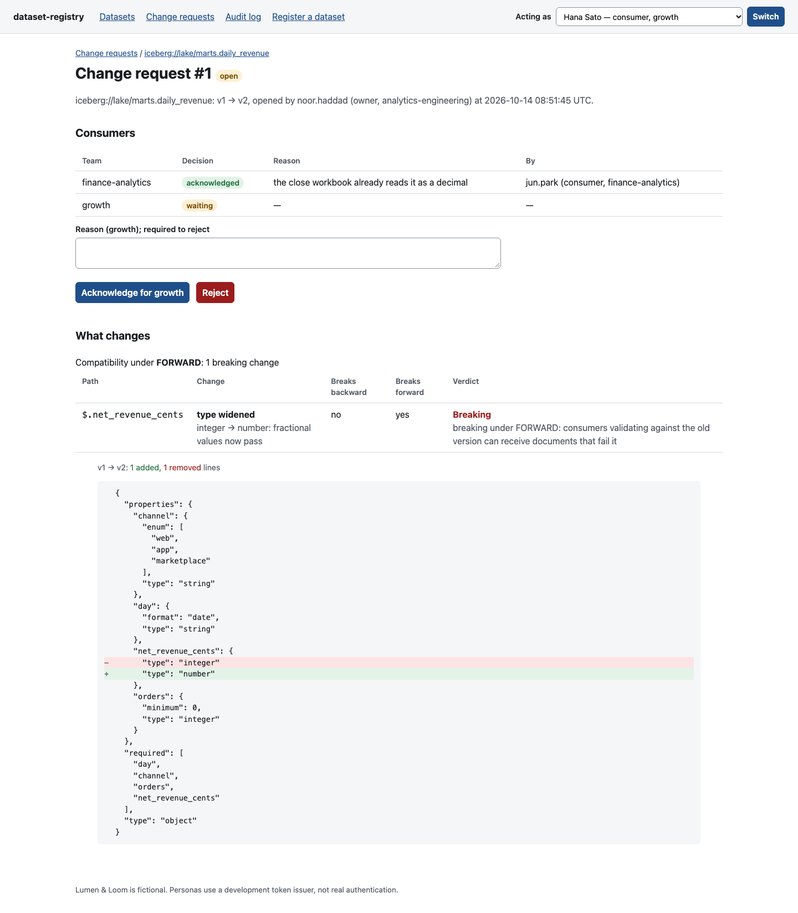
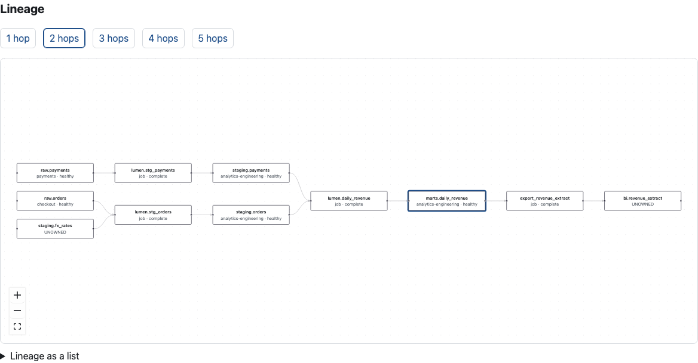
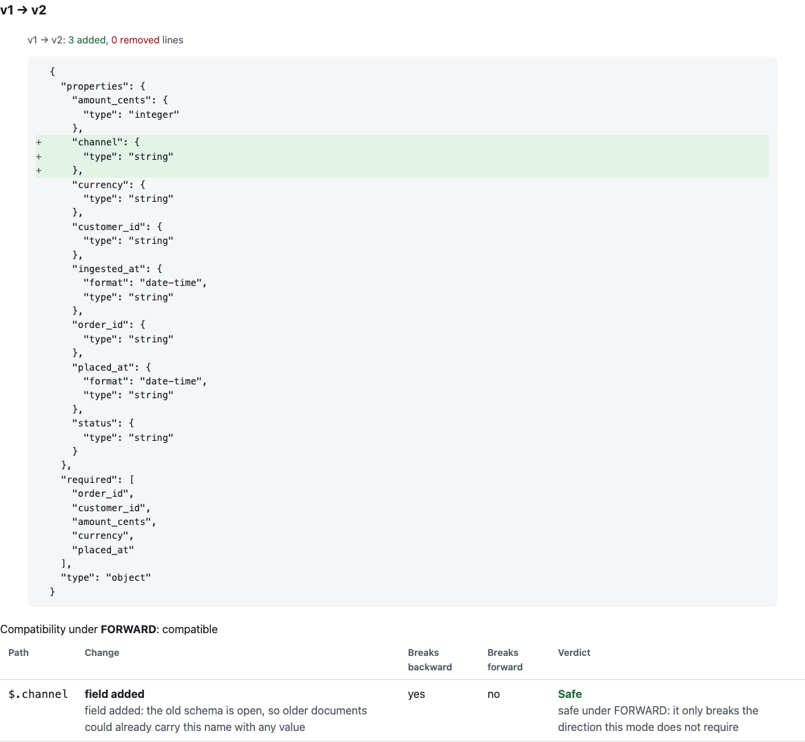

# dataset-registry

[](https://github.com/technobasant/dataset-registry/actions/workflows/ci.yml)
[](LICENSE)


**Ownership before consumption.** A data-ownership control plane: every dataset has an
owning team and a person, a freshness SLO, a versioned contract, lineage from OpenLineage,
and a list of the teams that depend on it. A breaking change to the contract does not get
blocked and does not get shipped quietly; it waits until every one of those teams has
acknowledged it.

The data belongs to Lumen & Loom, an online homewares retailer — a standard e-commerce
scenario shared with [governed-agent](https://github.com/technobasant/governed-agent),
[streaming-platform](https://github.com/technobasant/streaming-platform) and
[realtime-ml](https://github.com/technobasant/realtime-ml): orders and payments on Kafka,
landed in Iceberg by Spark, modelled by dbt, a few loads in Airflow, and a feature pipeline
for the ML team.

Three rules carry the design:

1. **Nobody can depend on a dataset that nobody owns.** Datasets that appear only in lineage
   are recorded as unowned; registering as a consumer of one is refused until a team claims
   it.
2. **A breaking change is a conversation, not an incident.** The checker says what changed
   and which direction it breaks. Compatible changes publish; breaking ones open a change
   request that each registered consumer acknowledges or rejects with a reason. The owner
   publishes only when all have acknowledged.
3. **Freshness is a promise with a clock.** Staleness is measured from the last successful
   run that wrote the dataset, as OpenLineage reported it, and a breach is a recorded
   transition and a Prometheus alert.



## What the measurements say

On one host (Apple M5; PostgreSQL 18 in a container; method, environment and every run in
[MEASUREMENTS.md](MEASUREMENTS.md)):

| Question | Measured |
|---|---|
| Does the checker ever call a breaking change safe? | **No**: 0 false negatives on 51 hand-labelled changes in BACKWARD, FORWARD and FULL. The labels are confirmed by an oracle that ran 8,092 probe documents through a real validator |
| How often does it cry wolf? | 2 of 51 per direction (96.1% accuracy): regex containment, `anyOf` and `multipleOf` are flagged as breaking both ways by design |
| How fast is OpenLineage ingest? | 1,221 events/s from one client at p50 0.72 ms; 8,782 events/s from 32 clients at p50 3.1 ms, p95 6.8 ms; 0 errors in 180,000 events |
| How fast are lineage queries? | Under 2.5 ms p50 for five hops in a 10,000-dataset graph; one hop costs the same at 100 and 10,000 datasets. Latency follows the neighbourhood (up to 1,817 nodes), not the graph |
| How late is a breach noticed? | Half the evaluator interval at the median, one interval at worst: 7.5 s p50 and 14.9 s max at the 15 s default |
| What is slow? | Listing all 1,000 datasets: 12.9 ms p50 (correlated subqueries per row). A mass status change across 10,000 SLOs: 3.1 s, one transaction per transition |
| Is the UI usable? | Lighthouse 99–100 on every category, desktop and mobile; automated audits only, no screen-reader testing |

## Quick start

```bash
git clone https://github.com/technobasant/dataset-registry && cd dataset-registry
make up        # PostgreSQL 18, API :8088, UI :3088, Prometheus :9098
make seed      # Lumen & Loom: 10 owned datasets, 8 dependencies, 6 h of Airflow/dbt/Spark runs
make demo      # unowned datasets, a breaking change acknowledged and published, lineage, SLOs
open http://localhost:3088
```

`make follow` keeps the healthy pipelines running; the inventory snapshot stays broken.
`make clean` removes everything, data included. Ports are overridable (`DR_API_PORT`,
`DR_WEB_PORT`, `DR_PG_PORT`, `DR_PROM_PORT`).

A pipeline reports lineage the way the OpenLineage HTTP transport does:

```bash
TOKEN=$(curl -s localhost:8088/api/v1/dev/tokens -d '{"subject":"airflow","role":"owner","team":"checkout"}' | jq -r .token)
curl -s localhost:8088/api/v1/lineage -H "Authorization: Bearer $TOKEN" -d @- <<'JSON'
{"eventType":"COMPLETE","eventTime":"2026-10-14T09:00:00Z","producer":"https://example.com/airflow",
 "schemaURL":"https://openlineage.io/spec/2-0-2/OpenLineage.json#/$defs/RunEvent",
 "run":{"runId":"7f1b8d2e-3c4a-4f5b-9a6c-1d2e3f4a5b6c"},"job":{"namespace":"airflow","name":"load_returns"},
 "inputs":[{"namespace":"iceberg://lake","name":"raw.orders"}],"outputs":[{"namespace":"iceberg://lake","name":"sales.returns"}]}
JSON
```

## Architecture



| Path | What it is |
|---|---|
| `api/internal/compat` | the checker, its 51 labelled cases and the probe oracle |
| `api/internal/registry` | ownership, consumers, contracts, change requests, audit |
| `api/internal/changereq` | the change-request state machine, nothing else |
| `api/internal/lineage` | OpenLineage validation, ingest, N-hop graph queries |
| `api/internal/freshness` | the SLO evaluator and its metrics |
| `api/internal/auth` | signed role tokens and the development issuer |
| `api/queries`, `api/migrations` | SQL compiled by sqlc; goose migrations embedded in the binary |
| `api/openapi/openapi.yaml` | OpenAPI 3.1, served at `/openapi.yaml` |
| `api/cmd/drbench` | seed, demo walkthrough and every benchmark |
| `web` | the UI and its Playwright tests |
| `docs/adr` | the decisions below, one page each |

## A breaking change





What the report says for each change is the part people read:

| Change | Breaks BACKWARD? | Breaks FORWARD? | Under the default (FORWARD) |
|---|---|---|---|
| optional → required | yes: history without it fails | no | safe |
| required → optional | no | yes: consumers can find it missing | breaking |
| integer → number | no | yes: consumers expecting integers get 12.5 | breaking |
| enum value added | no | yes: an unknown value reaches consumers | breaking |
| enum value removed | yes | no | safe |
| optional field added (open object) | yes, strictly: old documents may hold that name with another type | no | safe |
| optional field removed (open object) | no | yes: the name is now unconstrained | breaking |

Each consumer that rejects must say why. An admin cannot acknowledge on a team's behalf.
A team that no longer depends on the dataset can unregister, which drops its pending review.

<p>


</p>

## Decisions

| Decision | Instead of | Why | ADR |
|---|---|---|---|
| Go, one binary, sqlc over hand-written SQL | Python with an ORM | The SQL that matters (row locks, a partial unique index, a recursive lineage walk) is the SQL that runs, typed at compile time and checked current in CI; low per-event cost on the ingest path | [0001](docs/adr/0001-go-and-sqlc.md) |
| OpenLineage RunEvents, validated against the published schema | A custom lineage format and adapters | Airflow, dbt, Spark and Flink already emit it; unowned datasets fall out for free | [0002](docs/adr/0002-openlineage-not-custom-lineage.md) |
| JSON Schema, compatibility defined on validity sets, FORWARD by default | Avro resolution rules | The contracts describe Iceberg tables and JSON topics; one rule (absent fields take `additionalProperties`) replaces a table of special cases; FORWARD is the direction that protects consumers | [0003](docs/adr/0003-json-schema-validity-sets.md) |
| Breaking changes wait for every consumer's acknowledgement | Rejecting every breaking change | Blocking pushes teams to `_v2` tables and contracts that describe nothing; asking the people affected keeps the contract true | [0004](docs/adr/0004-acknowledgement-not-block.md) |
| Freshness from the last successful OpenLineage write, on an interval | Querying the data, or event-driven timers | No access to the data needed; the lag is bounded and measured | [0005](docs/adr/0005-freshness-from-last-successful-write.md) |
| HS256 role tokens, open reads, a development issuer | Building an identity provider | Makes the authorization rules real and testable; swapping in OIDC touches one package | [0006](docs/adr/0006-tokens-and-open-reads.md) |

## Quality gates

| Gate | Command | In CI |
|---|---|---|
| gofmt, `go vet`, golangci-lint v2.14.0 | `make lint-go` | yes |
| sqlc output is current | `make sqlc-check` | yes |
| OpenAPI 3.1 lint (Redocly 2.63.0) | `make openapi-lint` | yes |
| `go test -race`: unit tests, integration against PostgreSQL 18, coverage reported (73.6% of `internal/`) | `make test-go`, `make cover` | yes |
| ESLint, `tsc --noEmit`, `next build` | `make web-check` | yes |
| Playwright: register → consume → breaking change → acknowledge → publish; an SLO breach shows | `make e2e` | yes |
| `make up seed demo` on a clean runner, breach visible in `/metrics` | — | yes |

## Limits

- **Authentication is a development issuer.** Anyone who can reach `/api/v1/dev/tokens` when
  it is enabled can mint any role. Tokens are HS256 with one shared key. Reads are open.
- **Freshness means a pipeline said `COMPLETE`.** A job that writes nothing and reports
  success keeps its dataset fresh. The registry trusts producers' clocks.
- **The checker is structural.** `$ref`, `anyOf`/`oneOf`, `patternProperties`, `multipleOf`
  and changed regular expressions are treated as breaking both ways. A real corpus with
  heavy `$ref` use would see many false alarms. Avro and Protobuf contracts are not
  supported.
- **The labelled set was written by the same person as the checker.** It tests the rules the
  checker claims; it is not a sample of real-world schema changes.
- **A consumer that never answers blocks the owner.** There is no expiry or escalation.
  Consumers registered after a change request opened are not asked about it.
- **Lineage only grows.** Edges are never retired; `last_seen` is recorded but unused.
  Facets — including the output schema, which could be checked against the contract — are
  ignored.
- **One host.** Every figure in MEASUREMENTS.md is from one machine with PostgreSQL in a
  container; there is no network latency in them, and other projects' containers were
  running.
- **The audit log** resists the application, not a database superuser, who can drop the
  trigger.

## Roadmap

- OIDC token verification with group-to-role mapping; separate pipeline credentials.
- Check each run's OpenLineage schema facet against the published contract and record drift.
- Change-request expiry and escalation; notify consumers (webhook, chat) when one opens.
- Batch SLO transitions; keyset pagination and stored counts for the dataset list.
- Retire lineage edges not seen for N days; column-level lineage from the facet.
- Hash-chained audit log.
- Avro and Protobuf contracts behind the same report.

## Licence

Apache-2.0. See [LICENSE](LICENSE) and [NOTICE](NOTICE). The OpenLineage 2-0-2 JSON Schema
in `api/internal/lineage/spec` is the OpenLineage project's, also Apache-2.0.
